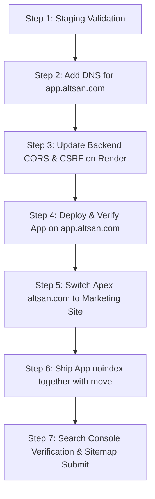

# Altsan Platform — Production Vercel Deployment & Domain Migration Guide

This document outlines the step-by-step procedure to deploy the public marketing website on `altsan.com`, transition the existing web application to `app.altsan.com`, configure domain email authentication (SPF, DKIM, DMARC), update backend origins, and manage search indexing.

---

## 1. Domain Email Authentication Setup (SPF, DKIM, DMARC)

Before opening inquiry forms to live traffic, configure domain DNS records at your DNS registrar (e.g., Cloudflare, Route53, Namecheap) to ensure high inbox deliverability and prevent spoofing.

### 1.1 SPF (Sender Policy Framework)
Authorizes the transactional email provider (e.g. Resend / SendGrid) to send emails on behalf of `@altsan.com`.
* **Type:** `TXT`
* **Name / Host:** `@` (or `altsan.com`)
* **Value:** `v=spf1 include:resend.com ~all`
* **TTL:** `3600` (1 hour)

### 1.2 DKIM (DomainKeys Identified Mail)
Cryptographically signs outbound inquiries to verify message integrity.
* **Type:** `CNAME` (or `TXT` depending on provider)
* **Name / Host:** `resend._domainkey.altsan.com`
* **Value:** *(Generated in Resend / SendGrid Dashboard, e.g. `resend._domainkey.resend.com`)*
* **TTL:** `3600`

### 1.3 DMARC (Domain-based Message Authentication)
Enforces rejection of unauthenticated emails spoofing the `@altsan.com` identity.
* **Type:** `TXT`
* **Name / Host:** `_dmarc` (or `_dmarc.altsan.com`)
* **Value:** `v=DMARC1; p=reject; rua=mailto:dmarc-reports@altsan.com; pct=100; aspf=r; adkim=r`
* **TTL:** `3600`

---

## 2. Staging Environment & Deployment Protection

The marketing site must be validated in staging prior to production deployment.

1. **Vercel Project Setup:**
   * Create a new Vercel Project named `altsan-marketing`.
   * Set Root Directory to `marketing-site`.
   * Set Build Command: `npm run build`
   * Set Output Directory: Automatically configured by `@astrojs/vercel`.
2. **Environment Variables for Staging:**
   ```bash
   STAGING=true
   ENVIRONMENT=staging
   PUBLIC_SITE_URL=https://staging.altsan.com
   APP_URL=https://app.altsan.com
   RESEND_API_KEY=re_staging_test_key...
   CONTACT_RECIPIENT_EMAIL=ops-staging@altsan.com
   PUBLIC_TURNSTILE_SITE_KEY=1x00000000000000000000AA
   TURNSTILE_SECRET_KEY=1x0000000000000000000000000000000AA
   ```
3. **Deployment Protection:**
   * In Vercel Project Settings > Deployment Protection, enable **Vercel Authentication** or **Password Protection** on preview and staging branches.
4. **Validation:**
   * Inspect HTML head: `<meta name="robots" content="noindex, nofollow" />` must be present.
   * Verify HTTP headers: `X-Robots-Tag: noindex, nofollow` returned on all pages.
   * Verify `https://staging.altsan.com/robots.txt` contains `User-agent: *\nDisallow: /`.

---

## 3. Production Migration Sequence (Exact Order)

> ⚠️ **CRITICAL ORDER OF OPERATIONS:** The application MUST be moved to `app.altsan.com` and verified BEFORE switching the apex domain (`altsan.com`) to the marketing site. Switching the apex prematurely will break active sessions and API communication.



### Step 3.1: Add DNS Record for the Web App
1. In your DNS provider, create a CNAME record:
   * **Type:** `CNAME`
   * **Host:** `app`
   * **Target:** `cname.vercel-dns.com`
   * **TTL:** `300` (Set low TTL to allow rapid changes)
2. In the existing Vercel project (`frontend-web`):
   * Navigate to **Settings > Domains**.
   * Add `app.altsan.com`.
   * Wait for SSL certificate issuance (typically 1–2 minutes).

### Step 3.2: Update Django Backend Environment Variables (Render)
Before redirecting users to `app.altsan.com`, update backend security origins in Render:
1. Log in to Render Dashboard > Web Service `altus-backend`.
2. Under **Environment**, update the following variables:
   * **`CORS_ALLOWED_ORIGINS`**:
     ```text
     https://app.altsan.com,https://altsan.com
     ```
     *(Keep `https://altsan.com` during transition to avoid breaking concurrent legacy sessions)*
   * **`CSRF_TRUSTED_ORIGINS`**:
     ```text
     https://app.altsan.com,https://altsan.com
     ```
3. Trigger a deployment of `altus-backend` and verify health:
   ```bash
   curl -I -H "Origin: https://app.altsan.com" https://api.altsan.com/api/v1/health/
   ```
   Confirm response contains `Access-Control-Allow-Origin: https://app.altsan.com`.

### Step 3.3: Verify App on `app.altsan.com`
1. Checklist for `frontend-web`:
   * Confirm `VITE_API_URL` points to `https://api.altsan.com`.
   * Confirm `service-worker.js` is registered under root scope (`/`).
2. Open `https://app.altsan.com/login` in an incognito window.
3. Test end-to-end authentication:
   * Request OTP code.
   * Verify OTP and receive JWT access/refresh tokens.
   * Verify supervisor dashboard, attendance check-in, and WebSocket connection.

### Step 3.4: Switch Apex (`altsan.com`) to the Marketing Project
1. In Vercel Project `altsan-marketing` > **Settings > Domains**:
   * Add `altsan.com` (Apex domain).
   * Add `www.altsan.com` (Redirect to `altsan.com`).
2. In your DNS provider:
   * Point Apex `@` to `76.76.21.21` (`A` record).
   * Point `www` to `cname.vercel-dns.com` (`CNAME`).
3. Configure Redirects in `marketing-site/vercel.json` for old app deep-links:
   ```json
   {
     "redirects": [
       { "source": "/login", "destination": "https://app.altsan.com/login", "permanent": true },
       { "source": "/app/:path*", "destination": "https://app.altsan.com/:path*", "permanent": true }
     ]
   }
   ```

### Step 3.5: Ship App Noindex Hardening
Together with the apex migration:
1. Deploy the `frontend-web` changes containing:
   * `<meta name="robots" content="noindex, nofollow" />` in `index.html`.
   * `X-Robots-Tag: noindex, nofollow` in `frontend-web/vercel.json`.
2. Confirm via curl:
   ```bash
   curl -I https://app.altsan.com/
   ```
   Verify `X-Robots-Tag: noindex, nofollow` header is returned.
3. **Important:** Do NOT disallow `app.altsan.com` in `robots.txt`. Search engine crawlers must be allowed to fetch the page so they can detect the `noindex` directive and de-index the application portal.

### Step 3.6: Google Search Console Verification
1. Go to Google Search Console and add the Domain property `altsan.com` (verified via DNS TXT record).
2. Submit the sitemap: `https://altsan.com/sitemap-index.xml`.
3. Inspect URL `https://altsan.com/` and confirm Googlebot can fetch and index the page.
4. Verify that `app.altsan.com` reports `Excluded by ‘noindex’ tag`.

---

## 4. PWA Installation & Session Impact Notice

> ℹ️ **Browser Storage Boundary Notice:** Because browser cookies, `localStorage`, `IndexedDB`, and Service Worker caches are strictly isolated per origin (protocol + domain + port), moving from `altsan.com` to `app.altsan.com` creates a new security origin.
>
> 1. **PWA Homescreen Apps:** Users who previously installed the PWA from `altsan.com` will need to open `https://app.altsan.com` in their mobile browser and re-add the app to their home screen.
> 2. **Active Sessions:** Any previously saved JWT refresh tokens on `altsan.com` will not transfer to `app.altsan.com`. All users must perform a one-time sign-in upon visiting the new domain.

---

## 5. Rollback Procedure

If a critical issue occurs during the domain transition (e.g., unexpected API failure or SSL delay on `app.altsan.com`):

1. **DNS Apex Rollback:**
   * In Vercel, assign `altsan.com` back to `frontend-web`.
   * In DNS, change `@` A record TTL to `300` and ensure traffic routes to the original application.
2. **Backend Security Settings:**
   * Ensure `CORS_ALLOWED_ORIGINS` and `CSRF_TRUSTED_ORIGINS` continue allowing `https://altsan.com`.
3. **Remove Noindex Meta:**
   * Revert the `frontend-web` noindex commit until the migration is rescheduled.
4. **Clear Caches:**
   * Purge Cloudflare or edge CDN caches to ensure users receive the restored routes.

